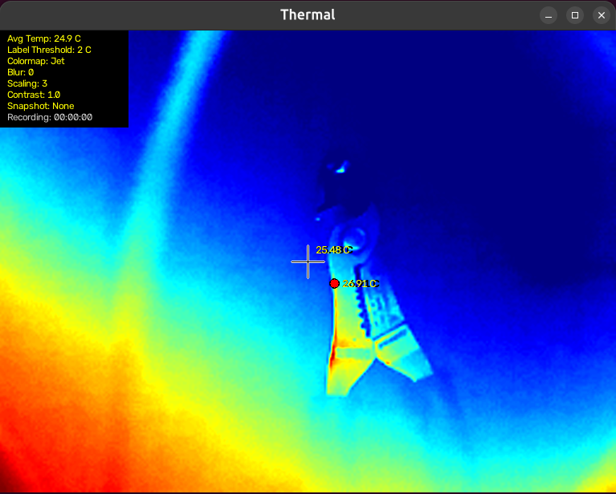
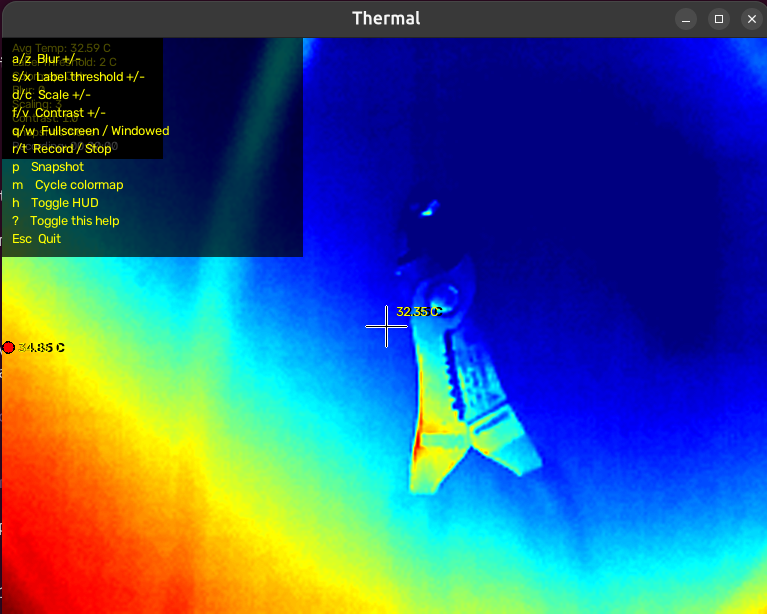

This is a Linux based software for using the Qianli Gorilla 6558 Microscope themrmal camera with Linux. This is based on the PyThermalCamera code base. This was a codebase is for Topdon TC001 Thermal Camera, and clones that the Qianli camera is based on.   https://github.com/leswright1977/PyThermalCamera* This has been compiled into an Appimage for multi distro use. 

## Install
1. Download `ThermalCam-*-x86_64.AppImage` from [Releases](../../releases/latest)
2. `chmod +x ThermalCam-*-x86_64.AppImage`
3. Plug in the camera and run it

If the camera isn't found, make sure your user is in the `video` group:
`sudo usermod -aG video $USER`, then log out and back in.

## Program
When opened the main screen will pop up

While open hit Shift + ? or / to see the key bindings

Current Key Bindings are:

a/z  Blur +/-
s/x  Label threshold +/-
d/c  Scale +/-
f/v  Contrast +/-
q/w  Fullscreen / Windowed
r/t  Record / Stop
p    Snapshot
m    Cycle colormap
h    Toggle HUD
?    Toggle this help
Esc  Quit
    

I recommend installing Flatpack and Gear Lever, this will allow any distro to drag and drop the appimage into Gear Lever and will add this to the programs list, Works on Gnome and KDE. 

*The original repo is broken where the Python Code will not work with the Python Numpy 2.0, so the code has been changed to make it work, it will also autodetect the stream of the camera when launched based on the resolution. The Appimage removed the dependencies and packaged everything into one download and launch. This is a work in progress so stay tuned

