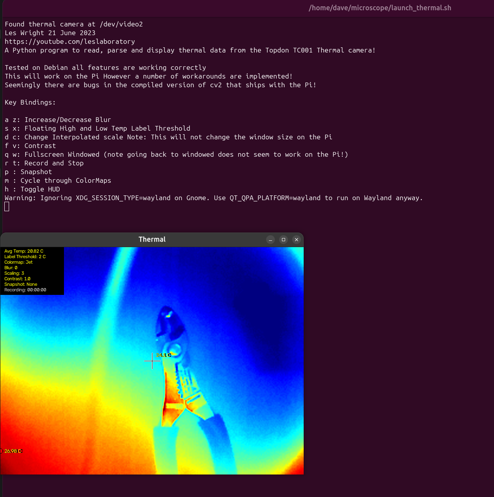

This is a Linux based software for using the Quanli Gorilla 6558 themrmal camera with Linux. This is based on the PyThermalCamera code base. https://github.com/leswright1977/PyThermalCamera This has been compiled into an Appimage for multi distro use. 

## Install
1. Download `ThermalCam-*-x86_64.AppImage` from [Releases](../../releases/latest)
2. `chmod +x ThermalCam-*-x86_64.AppImage`
3. Plug in the camera and run it

If the camera isn't found, make sure your user is in the `video` group:
`sudo usermod -aG video $USER`, then log out and back in.

## Program
This is what will pop up, the terminal window will show the keybindings, to close the program click the terminal window and hit Ctl+C, that is it!

The original repo is broken where the Python Code will not work with the Python Numpy 2.0, so the code has been changed to make it work, it will also autodetect the stream of the camera when launched based on the resolution. This is a work in progress so stay tuned

